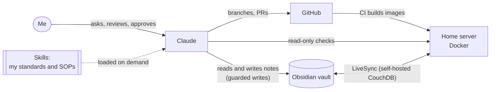
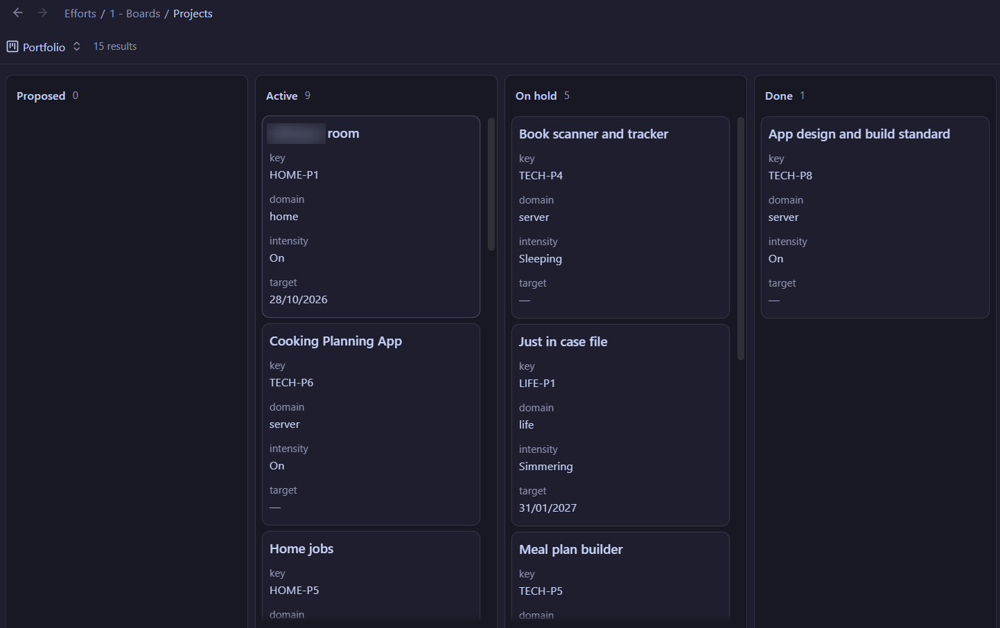
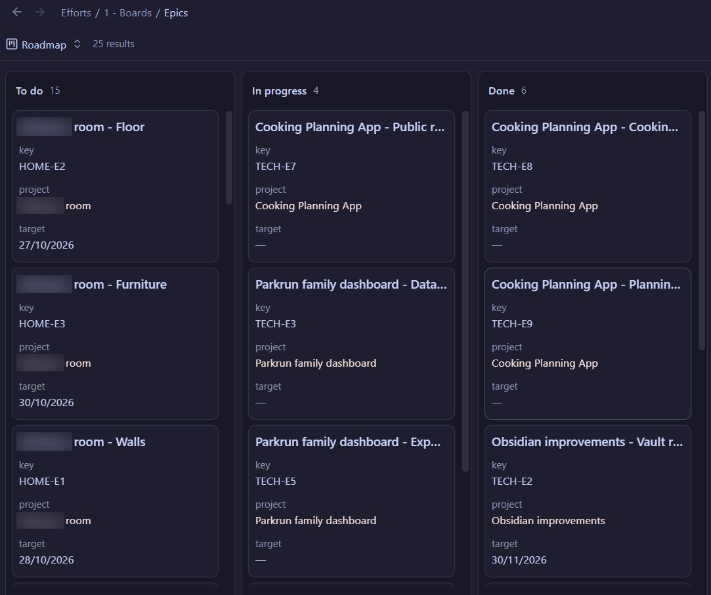
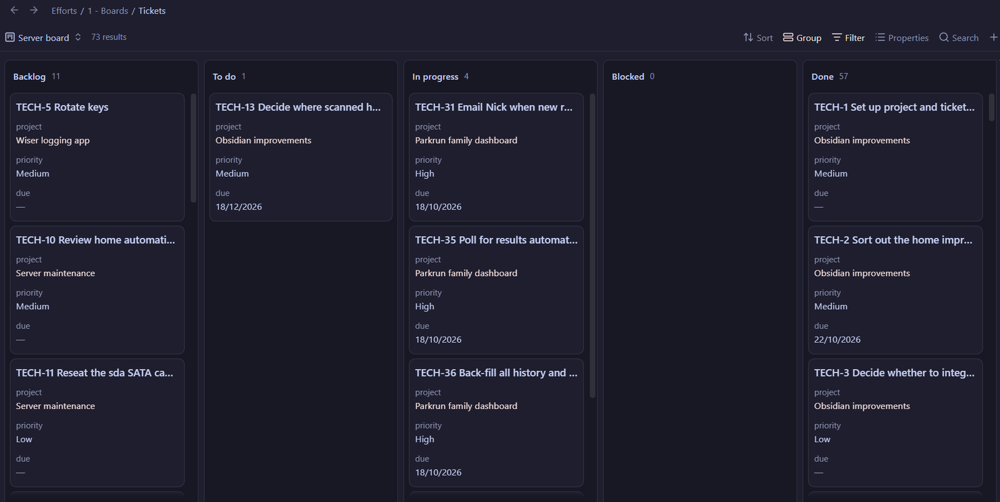
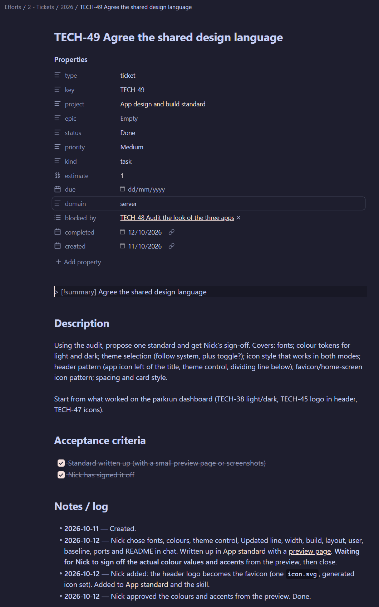
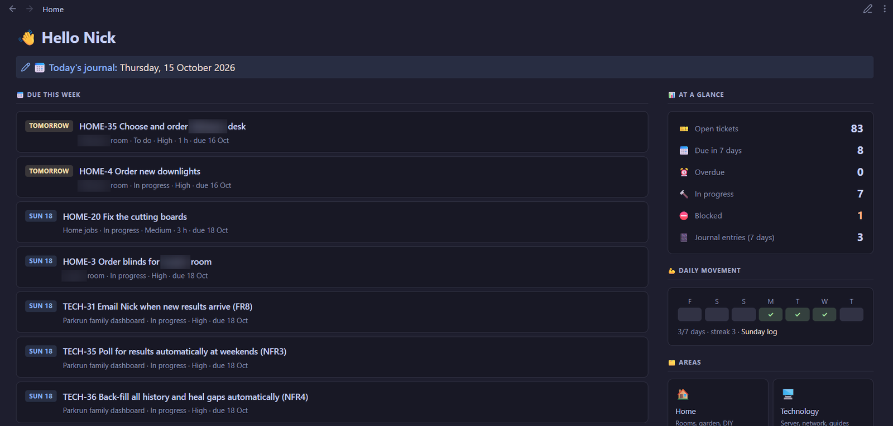
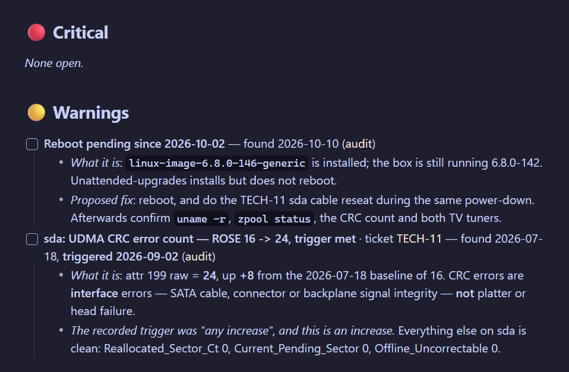

# Running life admin like a programme: Claude + Obsidian

I'm a technical project and programme manager. At home I use the same habits I use at work — start with a clearly defined outcome, then concise requirements, a single source of truth, tracked work, agreed standards and review gates — but with an AI agent (Claude) doing most of the hands-on work, and Obsidian as the system of record.

This page explains how that works, what the agent is and isn't allowed to do, and what I've learned about getting reliable results from it.

---

## The setup

- **Obsidian** holds everything: projects, tickets, decisions, standards, server documentation and runbooks. It syncs between devices through a self-hosted CouchDB (LiveSync), so nothing depends on a third-party sync service.
- **Claude** works in the vault through folder access on my laptop, in GitHub through pull requests, and on the server through a low-privilege, read-only account.
- **Skills** are short written procedures that Claude loads when a task needs them. They're how my conventions survive from one session to the next: think of them as SOPs for the agent. I have three main ones:
  - **Tickets** — how work is structured and keyed in the vault
  - **App standard** — how my self-hosted apps are designed, built and deployed
  - **Server audit** — how the home server is inspected and documented

---

## 1. Ticketing: Area → Project → Epic → Ticket

I track home and technical work in Obsidian the way a delivery team would in Jira, using Obsidian Bases for the boards and Templater for the templates.

**Outcomes and "done" come first.** Every epic opens with a one-line outcome, and every ticket has acceptance criteria, so what "done" looks like is agreed before the work starts, whether I write the ticket or Claude does. That matters more with an AI agent than with people: it fills gaps confidently, so the gaps need to be small.

| Level | What it is | Key |
|---|---|---|
| Area | A part of life (server, home, wellbeing, life) | — |
| Project | Something finite with an outcome | `TECH-P8` |
| Epic | A chunk of a project | `TECH-E3` |
| Ticket | One job: task, bug, spike or chore | `TECH-24` |
| Effort | Habits, ideas, on-hold decisions (no tickets) | — |

Hierarchy is held in properties, not folders, so re-parenting a ticket is a property change and never breaks a link or a key.

*Projects board: every project has a key, an area and a target date.*

*Epics board: each epic is a chunk of a project. Personal names are blurred.*

*The server tickets board in Obsidian Bases. Each card is a note; its key, project, priority and due date are note properties.*

*One ticket from the app standard project. Every ticket has the same properties, acceptance criteria and a dated log, whether I wrote it or Claude did.*

**What Claude does:** I ask in plain English — *"add a ticket to buy paint for the spare room"*, *"what's overdue?"*, *"close TECH-41"*, *"start a project for the garden fence"* — and Claude works out the right project, the next free key, the correct template and the allowed values, then writes the note.

**The guardrails:**
- It **reads a note before changing it**, and every write is checked against the file's last-modified time, so it can never overwrite an edit I've made in the meantime.
- It **can't rename, move or delete** anything. For one or two files it asks me to do it in Obsidian. For bulk changes it writes a Templater script with a **Preview** mode and an **Apply** mode, and I run it — so I see exactly what will change before it changes.
- Finishing a project goes through my own *Mark done* template, which archives it consistently.

---

## 2. Improving the quality of the data

A board is only as good as the data behind it. Most of the value has come from Claude keeping the vault tidy and consistent.

- **Controlled vocabularies.** Every property has an exact list of allowed values (statuses, priorities, kinds, domains). A typo would create a stray column on a board, so the agent checks values before writing.
- **Validating before committing.** Frontmatter is parsed and validated before a note is saved. One unquoted colon once made Obsidian reject a note's properties, which silently dropped it out of every board — now that's checked every time.
- **Vault reviews.** Claude has reviewed the whole vault against my conventions and proposed a reorganisation: consistent properties on every note, clear `up:` links to index notes, resolved issues moved out of live lists into an archive, and how-to notes collected as runbooks. I agreed the changes; it carried them out as tickets.
- **Root cause, not workaround.** At one point notes appeared to be reverting after edits, and sync looked like the culprit. Rather than adding retries, we ran small controlled tests and proved it was a stale copy in the file-transfer step, not sync at all. The fix (a fresh file per write, then a compare against what was intended) went into the skill so it never recurs.
- **The note wins.** Each skill points at a decision record in the vault. If they disagree, the vault is right and the skill gets updated — so the agent's instructions can't quietly drift from what I actually decided.

---

## 3. Creating scripts

Claude writes the small pieces of automation that would otherwise take me an evening each:

- **Templater scripts** for bulk renames, moves and archiving, always with Preview and Apply modes.
- **Live dashboards inside Obsidian** — for example a `dataviewjs` page that turns note properties into headline figures, a pipeline view, an activity heatmap and a "going stale" list. Before it went into the vault, it was tested in a headless browser against mock data, the same way you'd test any front end.
- **Bases views and formulas** — follow-up due, going stale, linked items via backlinks — so the vault answers questions instead of me searching it.
- **One-off checks** — contrast checks for colour choices, YAML validation, secret scans before a repo goes public.

*My Obsidian home page. Everything on it is built live from note properties: what is due this week, ticket counts and habit streaks. Personal names are blurred.*

---

## 4. From outcome to running software

My self-hosted apps (below) follow the same lifecycle I'd expect from a delivery team:

1. **Outcome first.** Each app starts from the problem it solves and how I'll know it worked (for the Cooking Planner: every dish ready at the same moment, and the plan adjusts when something runs late). That outcome is what every later decision is checked against.
2. **Then requirements.** Before any code, functional and non-functional requirements are agreed as tickets under a new project, each with acceptance criteria. Every app inherits the same NFRs: repo + CI image build, Docker deployment, light/dark themes, desktop + mobile, no public exposure, secrets out of the repo, health check and monitoring.
3. **A shared standard.** One decision record (project `TECH-P8`) sets a common look (fonts, neutral palette with one accent per app, theme toggle, a "last updated" freshness indicator), one repo layout and one deploy workflow (GitHub Actions → container registry → Docker Compose). New apps start compliant instead of being retrofitted.
4. **Evidence before review.** Claude runs the app on demo data and screenshots it at desktop and phone widths, light and dark, checking for console errors and layout problems, before asking me to look.
5. **A human gate.** Work goes on a branch with a pull request listing what changed and the exact deploy steps. I review and say "merge". It merges once CI is green; I deploy and check against the acceptance criteria; only then are the tickets closed.

---

## 5. Server operations and documentation

A separate skill lets Claude inspect the home server and keep its documentation current.

- **Read-only by default**, over a dedicated low-privilege account. Anything that changes state (restarting a container, editing config, installing packages) is described with the exact command and why — and only run if I confirm that specific action.
- **Secrets are never printed.** They're referred to by name, never value, and live outside the skill and outside every repo.
- **Findings land in Obsidian**: an audit note per review, a live "outstanding issues" list classified Critical / Warning / Info, and a resolved archive. Open issues can link to tickets, so an audit finding becomes tracked work rather than a note that gets forgotten.
- **My writing is protected.** The agent only rewrites clearly marked sections of a note; anything I've written outside those markers is left alone.

*Part of the server's Outstanding Issues note, kept up to date by audits. Each finding says what it is and the proposed fix, with a measured baseline and trigger where relevant, and links to a ticket when it becomes work.*

---

## What I've learned

- **Start with the outcome, not the task.** A clear outcome and acceptance criteria are the best brief you can give an AI agent, just as they are for a team.
- **Write the standard down once, then make the agent follow it.** Skills are cheap SOPs. Most "AI did something odd" moments were really "I hadn't written down what good looks like".
- **Keep a human in the loop where it matters, not everywhere.** I check the key outputs — merges, deploys, anything destructive — rather than every line. Guardrails (read-before-write, no deletes, preview/apply, least privilege) make that safe.
- **One source of truth.** The vault is the record; code, skills and dashboards point back to it.
- **Treat it like a team member.** Clear briefs, agreed acceptance criteria, evidence before review and a retrospective when something goes wrong get far better results than clever prompts.

---

## Projects built this way

| Project | The outcome |
|---|---|
| [Cooking Planner](https://github.com/nick-a-louse/cooking-planner) | Big meals land on time: every dish is ready at the same moment, and the plan adjusts when something runs late |
| [Heating history](https://github.com/nick-a-louse/wiser-history) | See which rooms run cold and when, so the heating can be tuned on evidence rather than guesswork |
| [Kavita Age-Rater](https://github.com/nick-a-louse/kavita-age-rater) | Children's accounts only see age-appropriate books, without rating a whole library by hand. AI suggests, a person approves |
| [parkrun family dashboard](https://github.com/nick-a-louse/parkrun-family-dashboard) | One place for the family's results, PBs and milestones, with an email when new results land, instead of checking several pages every weekend |
| [TfL departure board](https://github.com/nick-a-louse/tfl-departure-board) | Know whether to leave now with a glance at the wall, not an app |

*Code in these repos was largely written by Claude under my direction. My part was the requirements, the standards, the review and the decisions.*
